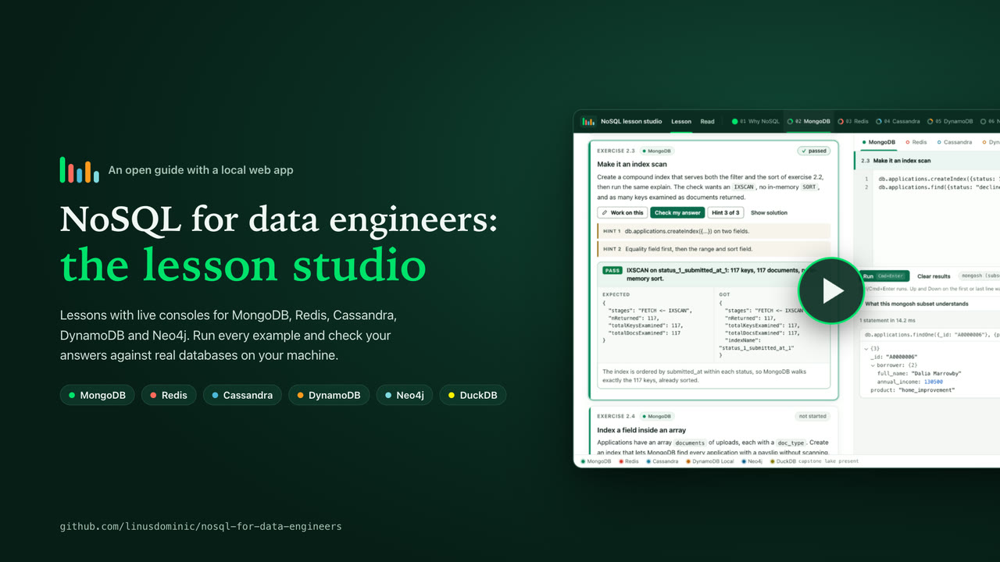
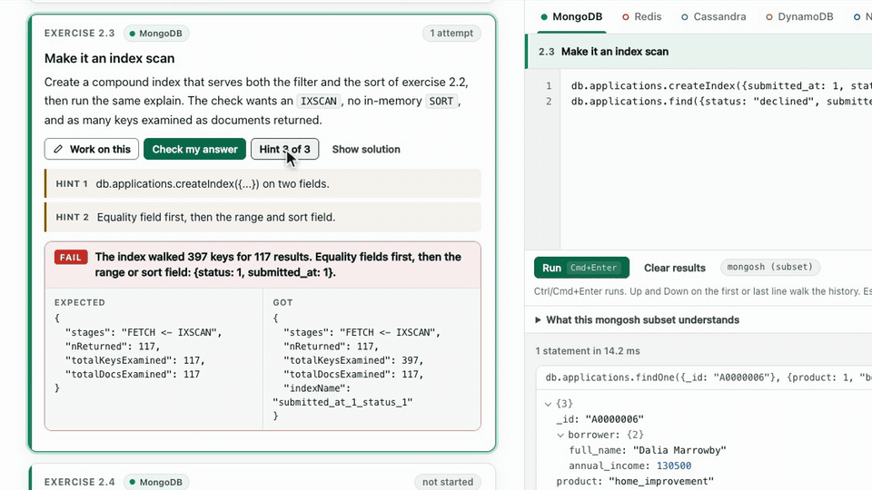
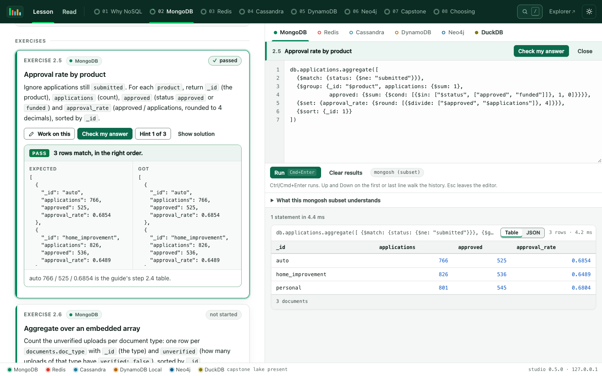
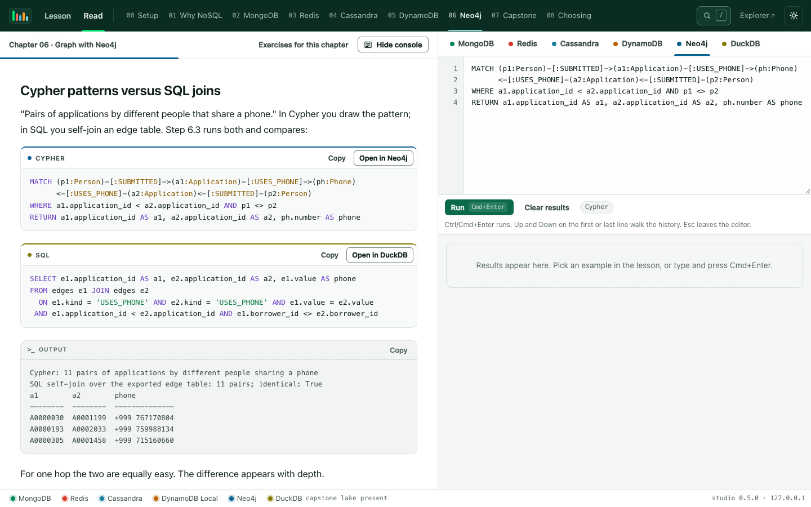
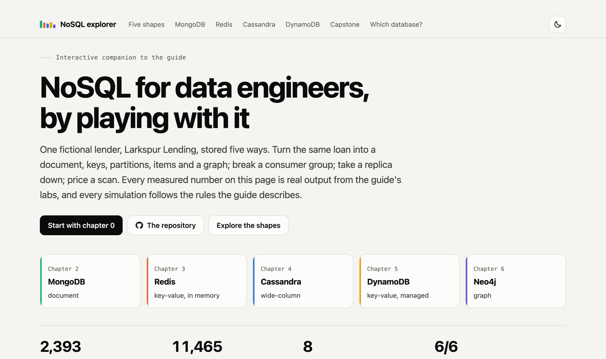
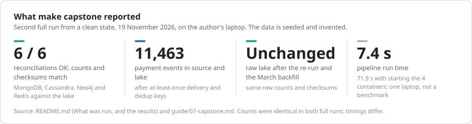

# NoSQL for data engineers

A hands-on guide for data engineers who know SQL and Python and have never used a NoSQL
database. It explains what document, key-value, wide-column and graph databases are,
how each one models data, and above all how a data engineer works with them: getting
data in, getting it out into Parquet and DuckDB, incremental extraction and change data
capture, schema drift, idempotency, reconciliation, and choosing the right store.

Every chapter has prose, a runnable lab against a real database in Docker, exercises,
reference solutions, and a check command that tells you whether your answer is right.
The lesson studio puts the same chapters in your browser, with consoles connected to the
databases on your machine.

```text
$ make capstone
...
OK   mongo applications (id, status, updated_at) source    2390  lake    2390  checksum match
OK   mongo loans (id, principal, rate)          source    1478  lake    1478  checksum match
OK   cassandra payment events                   source   11463  lake   11463  checksum match
OK   cassandra daily counters vs lake sums      source     332  lake     332  checksum match
OK   neo4j identity edges                       source    7170  lake    7170  checksum match
OK   redis dedup keys vs lake events (count)    source   11463  lake   11463  checksum match
...
reconciliation: 6/6 OK; re-run and backfill idempotent: True
capstone finished in 7.4s: PASS
```

(The capstone's last lines on the author's machine: four NoSQL sources copied into a
Parquet lake, modelled in DuckDB, reconciled with counts and checksums.)

<picture>
  <source media="(prefers-color-scheme: dark)" srcset="docs/img/architecture-dark.svg">
  
</picture>

## Lesson studio

The main way to work through the guide: a local web app with each chapter as a lesson, step
by step, next to a console connected to the real database. Read a short step (or the
guide section it comes from, in the studio's own reader), press **Run this** on an
example, then do the exercises in the console and press **Check my answer**: it runs your
statement and the reference solution against the database and says PASS or FAIL, with
what was expected and what you got.

**See it in action:** a 2 minute 54 second walk-through, from `git clone` to an exercise
that fails, gets a hint and passes, then a tour of chapters 3 to 8, search and the dark
theme. Click the picture to play it.

[](https://linusdominic.github.io/nosql-for-data-engineers/media/studio-demo.mp4)

[Watch the video](https://linusdominic.github.io/nosql-for-data-engineers/media/studio-demo.mp4)
(MP4, 26 MB, quiet music, no voice) or open [the file in this repository](docs/media/studio-demo.mp4).
`make demo-video` records it again after a change to the studio
([tools/record_demo.py](tools/record_demo.py)).



```bash
make setup
make up-capstone up-05   # every database; or only the chapter's, e.g. make up-02
make studio              # prints http://127.0.0.1:8790/?token=... : open that address
```

- **Consoles in each database's own language:** mongosh for MongoDB (a subset, interpreted
  in Python), redis-cli syntax for Redis, CQL for Cassandra with `TRACING ON` and
  `CONSISTENCY`, PartiQL or a JSON API mode for DynamoDB Local (with ConsumedCapacity),
  Cypher for Neo4j with `PROFILE` summarised, and SQL over the Parquet lake in DuckDB.
  Line numbers, Ctrl/Cmd+Enter to run, history on Up and Down, results as a table or a
  JSON tree, timings and readable errors.
- **48 checked exercises:** 10 for MongoDB, 8 for Redis, 9 for Cassandra, 9 for
  DynamoDB, 7 for Neo4j and 5 over the capstone's lake, plus the 6 and 7 quiz questions
  of chapters 1 and 8. Each exercise has up to three hints, and its
  solution opens after your first attempt.
- **The guide, inside the studio:** **Read** at the top shows every chapter, 0 to 8,
  rendered from `guide/*.md` on each request: a table of contents that follows your
  place, a link to copy on every heading, reading progress, previous and next chapter,
  the three diagrams in light and dark, scrollable tables, and lab output styled as
  output. Every database statement in the guide has **Open in console**, which loads it
  into the right console (Cypher into Neo4j, CQL into Cassandra, SQL into DuckDB);
  shell and Python blocks only have **Copy**. **Read this section** on a lesson step
  opens the reader at that heading next to the console, and **Back to step** returns.
  `/` searches every chapter, and a repository file named in the text opens in a
  read-only viewer. Nothing sends you to GitHub; outside links open in a new tab with no
  referrer.
- **Prepare data** loads a chapter's data with the lab's own code and the seeded generator,
  so the numbers match the guide. Chapter 7 runs the capstone from the browser and
  streams each stage.
- **Local only:** the server listens on 127.0.0.1, every API call needs the random token
  from the printed address, and requests with a foreign Host or Origin are refused. There
  is no shell: only the database consoles. Progress is saved in `.studio/progress.json`.
  Raw HTML in the guide is shown as text, never run; the file viewer shows `guide/`,
  `src/`, `exercises/`, `solutions/`, `tests/`, `tools/` and `docs/` only (not the
  studio's lesson files, which hold the solutions), and refuses `..`, absolute paths,
  hidden files and symlinks that lead out.

How to use it with the chapters: [guide/00-setup.md](guide/00-setup.md#the-lesson-studio-the-chapters-in-a-browser-with-live-consoles).

<picture>
  <source media="(prefers-color-scheme: dark)" srcset="docs/img/studio-dark.png">
  
</picture>

<picture>
  <source media="(prefers-color-scheme: dark)" srcset="docs/img/studio-reader-dark.png">
  
</picture>

## Who it is for

- You write SQL every day and some Python.
- You have been asked to pull data out of MongoDB, Cassandra, DynamoDB, Redis or Neo4j,
  or to help choose one, and want to understand what you are dealing with.
- You prefer running things to reading about them.

You do not need to know any NoSQL database, Docker beyond `docker compose up`, or AWS.

## Prerequisites

- Docker Desktop or Docker Engine with Compose v2, with about 5 GB of memory available
  for the capstone (a single chapter needs much less) and about 4 GB of disk for images.
- [uv](https://docs.astral.sh/uv/) (it installs Python 3.12 for you), `make` and `git`.
- No cloud account: DynamoDB runs as DynamoDB Local.

## Quickstart (5 minutes, once the images are downloaded)

```bash
git clone https://github.com/linusdominic/nosql-for-data-engineers.git
cd nosql-for-data-engineers
make setup          # uv sync --python 3.12: creates .venv with the pinned libraries
make check-01       # the chapter 1 quiz; no database needed (fails until you answer it)
make up-02          # start MongoDB, wait until healthy
make lab-02         # run the chapter 2 lab: every step prints its result
make check-02       # check your chapter 2 exercises
make studio         # or do it all in the browser: the lesson studio (see above)
make down           # stop and delete the containers
```

Then open [guide/00-setup.md](guide/00-setup.md) and work through the chapters in order.

## Interactive explorer

A companion page for playing with the ideas before or alongside the chapters: the same
loan as SQL tables, a MongoDB document, Redis keys, Cassandra tables, DynamoDB items and
a Neo4j graph; a Redis Streams consumer group you can crash; a Cassandra consistency
playground; a DynamoDB capacity calculator; the capstone pipeline with each run's counts;
and a "which database?" walk through chapter 8. Measured numbers on it are real lab
output, each tied to the line of the guide it comes from (a unit test keeps them in
sync); the interactive parts are simulations and say so.

**Open it online: [linusdominic.github.io/nosql-for-data-engineers](https://linusdominic.github.io/nosql-for-data-engineers/explorer/)**,
or from a clone open [`docs/explorer/index.html`](docs/explorer/index.html) in a browser
(no server or install needed), or run `make explorer` and open the address it prints.

<picture>
  <source media="(prefers-color-scheme: dark)" srcset="docs/img/explorer-dark.png">
  
</picture>

## Learning path

| # | Chapter | Database | Time | Start with |
|---|---|---|---|---|
| 0 | [Setup and how to use this guide](guide/00-setup.md) | none | 20 min | `make setup` |
| 1 | [Why NoSQL exists](guide/01-why-nosql.md): families, CAP and PACELC, consistency, when not to | none | 50 min | `make check-01` |
| 2 | [Document stores with MongoDB](guide/02-document-stores-mongodb.md): embed vs reference, indexes, aggregation, validation, transactions, flattening, drift, watermarks, change streams | MongoDB 8.0 | 2 h | `make up-02` |
| 3 | [Key-value with Redis](guide/03-key-value-redis.md): data structures, TTL, eviction, persistence, caching, idempotency keys, rate limits, streams with consumer groups | Redis 8.2 | 1.5 h | `make up-03` |
| 4 | [Wide-column with Cassandra](guide/04-wide-column-cassandra.md): query-first modelling, hot partitions, tombstones, consistency levels, LWT, token-range extraction | Cassandra 5.0 | 2 h | `make up-04` |
| 5 | [DynamoDB with DynamoDB Local](guide/05-dynamodb.md): single-table design, GSIs, scans, conditional writes, transactions, Streams, TTL, export | DynamoDB Local 3.3 | 2 h | `make up-05` |
| 6 | [Graph with Neo4j](guide/06-graph-neo4j.md): Cypher vs joins, fraud rings, PROFILE, exporting graph results | Neo4j 5.26 | 1.5 h | `make up-06` |
| 7 | [Capstone](guide/07-capstone.md): four sources to a Parquet lake, `fct_loan` and a delinquency mart, re-run, backfill, reconciliation | all but DynamoDB | 2.5 h | `make capstone` |
| 8 | [Choosing a NoSQL database](guide/08-choosing-a-nosql-database.md): decision guide, comparison, anti-patterns, managed services, search and time-series, glossary, review questions | none | 1 h | `make check-08` |

About 13 hours in total. The times are estimates for reading, running and doing the
exercises, not measurements.

## How labs and checks work

- `make lab-NN` runs `src/nosqlde/labs/chNN_*.py`. Each lab recreates its own data first,
  so it is safe to re-run, and prints each step's result. The guide quotes that output.
- `exercises/chNN_*.py` contains functions that raise `NotImplementedError`; their
  docstrings say what to build. `make check-NN` runs your functions against the live
  database and prints PASS or FAIL with a hint.
- `make check-NN SOLUTIONS=1` checks the reference answers in `solutions/` instead.
- Everything uses one seeded, deterministic dataset for a fictional lender
  ([`src/nosqlde/datagen.py`](src/nosqlde/datagen.py)), so your counts should match the
  guide exactly; only timings and a few server-generated ids differ.

All data is invented: Larkspur Lending, its borrowers, employers, streets and towns do
not exist. Phone numbers use the unassigned `+999` prefix and emails use `example.com`.

## Repository layout

```text
guide/                 the chapters (start at 00-setup.md)
src/nosqlde/           the shared package
  datagen.py           seeded generator for the fictional lender
  flatten.py           nested documents -> tables
  drift.py             conform rows to a schema and count drift
  lake.py              atomic Parquet writes, pipeline state
  recon.py             counts and order-independent checksums
  graph.py             connected components (union-find)
  labs/                one lab per chapter (2 to 6)
  checks/              one check per chapter (1 to 8)
  capstone/            sources, extract, model, reconcile, pipeline
  studio/              the lesson studio (make studio)
    server.py          FastAPI app, fixed jobs (capstone, labs)
    security.py        token, Host and Origin checks, security headers
    reader.py          the guide reader: Markdown to HTML, links, console detection, search
    repofiles.py       the read-only file viewer's path rules
    runners/           one console per database
    mongosh.py         the mongosh subset: parser and planner
    lessons/           one lesson per chapter, and prepare.py
    checking.py        PASS or FAIL against the reference solution
    static/            the page: HTML, CSS and JavaScript, no build step; diagrams/ as SVG
tools/                 build_explorer_data.py; render_diagrams.py (make diagrams) with mermaid in vendor/
exercises/             your work: starter files
solutions/             reference answers
tests/unit/            no database needed
tests/integration/     every lab, check, the capstone and every studio exercise, against the containers
docker-compose.yml     one profile per chapter, plus "capstone"
Makefile               every command in this README
```

## Pinned versions

Container images (each tag was pulled on the author's machine; all are multi-arch and
ran natively on Apple silicon). Sizes are as reported by `docker images` on arm64:

| Image | Size | Licence (checked in the image or the source at that tag) |
|---|---|---|
| `mongo:8.0.38` | 1.27 GB | MongoDB Community Server: Server Side Public License (SSPL) v1, per the package's `copyright` file |
| `redis:8.2.11-alpine` | 101 MB | Redis 8 is tri-licensed: RSALv2, SSPLv1 or AGPLv3, at your choice (`LICENSE.txt` at tag 8.2.11); the image bundles modules (search, JSON, time series, probabilistic) under the same terms |
| `cassandra:5.0.9` | 568 MB | Apache License 2.0 (`/opt/cassandra/LICENSE.txt`) |
| `amazon/dynamodb-local:3.3.2` | 828 MB | Amazon DynamoDB Local License Agreement, a proprietary AWS licence (`/home/dynamodblocal/LICENSE.txt`); not open source |
| `neo4j:5.26.33-community` | 953 MB | Neo4j Community Edition: GPLv3 (`/var/lib/neo4j/NOTICE.txt`) |

The licence summaries are a reading of those files, not legal advice. This repository's
own code is MIT-licensed ([LICENSE](LICENSE)); it does not include or redistribute any of
the database software, which Docker downloads from its publishers.

Python 3.12 and libraries, pinned in `pyproject.toml` and locked in `uv.lock`:

| Library | Version | Used for |
|---|---|---|
| pymongo | 4.20.0 | MongoDB |
| redis | 8.1.0 | Redis |
| cassandra-driver | 3.30.1 | Cassandra (on Python 3.12 it uses its bundled libev event loop; verified on macOS arm64) |
| boto3 | 1.44.6 | DynamoDB Local |
| neo4j | 6.4.1 | Neo4j |
| duckdb | 2.0.0 | the analytics side |
| pyarrow | 26.0.1 | Parquet |
| fastapi | 0.162.0 | the lesson studio's server |
| uvicorn | 0.54.0 | the lesson studio's server |
| markdown-it-py | 4.2.0 | the studio's guide reader (CommonMark plus tables, raw HTML off); brings mdurl 0.1.2 |
| pytest, ruff, mypy (dev) | 9.2.0, 0.17.5, 2.4.1 | tests and linting |
| httpx (dev) | 0.28.1 | the studio's HTTP tests (Starlette's TestClient) |

The guide's three diagrams are pre-rendered to SVG with mermaid 12.3.0 (MIT; downloaded from
npm on first use, checked against a pinned sha256 and cached in `tools/.cache/`) by
`make diagrams`, which runs it in headless Chrome. Mermaid is not shipped to the browser
and is not needed at runtime.

## What was run, and the results

The whole path was run from a clean state (no containers, no `.venv`, no `lake/`) on
the author's machine: macOS on Apple silicon, Docker Desktop 29.6.2 with about 8 GB for
containers, uv 0.13.6. Images were already downloaded, so pull time is not included.
Timings include `make` and `uv run` start-up.

Second full run, 19 November 2026 (the first full run passed every step except
`make lint`, because ruff 0.17 also formats Python code blocks inside Markdown; the guide
is now excluded from ruff and the whole path was run again):

<picture>
  <source media="(prefers-color-scheme: dark)" srcset="docs/img/capstone-results-dark.svg">
  
</picture>

| Step | Command | Result | Time |
|---|---|---|---|
| install | `make setup` | 32 packages installed into a new `.venv` (uv cache warm) | 0.2 s |
| ch. 1 | `make check-01 SOLUTIONS=1` | 6/6 passed | 5.8 s (first `uv run` builds the project) |
| ch. 2 | `make up-02` / `lab-02` / `check-02 SOLUTIONS=1` / `down` | healthy; lab ran; 4/4 passed | 11.3 / 5.8 / 2.1 / 0.6 s |
| ch. 3 | `make up-03` / `lab-03` / `check-03 SOLUTIONS=1` / `down` | healthy; lab ran; 4/4 passed | 3.7 / 8.5 / 0.6 / 0.6 s |
| ch. 4 | `make up-04` / `lab-04` / `check-04 SOLUTIONS=1` / `down` | healthy; lab ran; 4/4 passed | 63.3 / 12.5 / 1.7 / 5.1 s |
| ch. 5 | `make up-05` / `lab-05` / `check-05 SOLUTIONS=1` / `down` | healthy; lab ran; 4/4 passed | 3.8 / 9.7 / 4.1 / 0.9 s |
| ch. 6 | `make up-06` / `lab-06` / `check-06 SOLUTIONS=1` / `down` | healthy; lab ran; 4/4 passed | 5.8 / 3.4 / 1.6 / 10.6 s |
| ch. 7 | `make capstone` (includes starting 4 containers) | PASS: 6/6 reconciliations OK, re-run and backfill idempotent | 71.9 s (pipeline itself 7.4 s) |
| ch. 7 | `make check-07 SOLUTIONS=1` | 4/4 passed | 0.6 s |
| ch. 8 | `make check-08 SOLUTIONS=1` | 7/7 passed | 0.7 s |
| unit tests | `make test` | 49 passed | 2.6 s |
| lint | `make lint` | ruff: all checks passed; 57 files already formatted; mypy --strict: no issues in 33 source files | 4.5 s |
| integration | `make up-capstone up-03 up-05`, then `make test-integration` | 11 passed (5 labs + checks against solutions, 5 starter-file checks, capstone + chapter 7 check) | 67.8 s + 40.9 s |

The unit, lint and integration rows above are from the second full run; versions 0.3.0's
and 0.4.0's are below.

### The lesson studio (0.3.0), 19 November 2026

Same machine, Docker Desktop 29.6.2, containers started with `make up-capstone up-05`,
the studio started with `make studio`. The browser was Google Chrome 157, headless,
driven through the DevTools protocol: it pressed the buttons a learner presses and saved
screenshots in light and dark at 1,440 pixels wide, and at 1,280, 1,024 and phone width.

| Step | How | Result | Time |
|---|---|---|---|
| install | `uv sync --python 3.12` into a new environment | 47 packages installed (uv cache warm) | 0.1 s |
| Prepare data | the button in chapters 2 to 6 | MongoDB 2,393 applications; Redis 8 keys and a 21-entry stream; Cassandra 11,465 payments per table; DynamoDB 18,814 items; Neo4j 7,179 edges exported | 0.72 / 0.02 / 4.03 / 4.64 / 0.92 s |
| capstone | **Run the capstone** in chapter 7 | stages streamed; reconciliation 6/6 OK, re-run and backfill idempotent, PASS; same DPD table as chapter 7 | pipeline 5.5 s, job 6.3 s |
| every solution | `POST /api/check` with each reference solution, and the quizzes' answers | 48 of 48 exercises PASS, 13 of 13 questions right | 1.8 s |
| browser | the walk-through above | no errors or warnings in the browser console | |
| unit tests | `make test` | 418 passed, 282 of them for the studio (mongosh parser 110, lesson integrity 102, consoles 35, security 23, comparison 12) | 2.7 s |
| lint | `make lint` | ruff: all checks passed; 94 files already formatted; mypy --strict: no issues in 62 source files | |
| integration | `make test-integration` | 60 passed: the 11 above plus, for every studio exercise, the solution passes and each listed wrong answer and a do-nothing statement fail; and one HTTP test with the token | 56.4 s |

Every `make check-NN` on the untouched starter files exited non-zero with
"not implemented yet" for each exercise, as intended. The capstone's numbers
(2,390 applications, 1,478 loans, 11,463 payment events, 7,170 graph edges, 6/6
reconciliations) and every lab's counts were identical in both full runs; only timings,
Redis eviction counts, stream ids, DynamoDB sequence numbers and one Neo4j db-hit count
differed.

### The guide reader (0.4.0), 19 November 2026

Same machine, uv 0.13.6, Google Chrome 157 (headless, driven through the DevTools
protocol), the studio started on a second port next to a running one.

| Step | How | Result | Time |
|---|---|---|---|
| install | `uv sync --python 3.12 --locked` into a new environment | 49 packages installed (uv cache warm) | 87 ms |
| diagrams | `make diagrams` | 3 diagrams, light and dark; a second run wrote byte-identical files | 1.4 s |
| render | each chapter, first render | chapters 0 to 8 rendered; about 2 to 4 ms each | |
| browser | all 9 chapters in light and dark at 1,440 and 1,024 pixels (36 loads), phone width; Open in console, Read this section and back, search, the file viewer, a refused path | every chapter and diagram loaded, no sideways page scroll; no errors or warnings in the browser console, except the server's 400 or 403 for a refused path | |
| unit tests | `make test` | 503 passed, 85 of them for the reader and the file viewer | 3.1 s |
| lint | `make lint` | ruff: all checks passed; 98 files already formatted; mypy --strict: no issues in 64 source files | |

`make test-integration` was not run for this version: it prepares and resets the
studio's databases, which were in use at the time, and the reader changes none of the
code it covers.

## Troubleshooting

**A port is already in use** (`Bind for 0.0.0.0:27117 failed: port is already allocated`).
Find what uses it with `lsof -nP -iTCP:27117 -sTCP:LISTEN`. Either stop that, or change
the host side of the port in `docker-compose.yml` (`"27118:27017"`) and export the
matching variable before running labs, for example `export NOSQLDE_MONGO_URI="mongodb://localhost:27118/?directConnection=true"`.
The variables are listed in [`src/nosqlde/config.py`](src/nosqlde/config.py).

**A container never becomes healthy** (`make up-NN` fails with "container ... is unhealthy").
Look at `make ps` and `make logs`. Cassandra needs 40 to 60 seconds and more on a busy
machine; run `make up-04` again, which waits again. MongoDB's health check also
initiates the single-node replica set; if it keeps failing, `make down` and retry, which
starts from an empty data directory.

**Out of memory** (a container exits with code 137, or Docker Desktop becomes slow).
Give Docker more memory (Settings > Resources), or run one chapter at a time with
`make down` in between. The capstone needs MongoDB, Redis, Cassandra and Neo4j together;
their caps add up to about 4.5 GB, and observed use was about 2.5 GB
(see [chapter 0](guide/00-setup.md#memory)).

**Apple silicon.** All five images publish arm64 builds and run natively; no emulation is
needed. If you see `exec format error` or an `amd64` warning, you have an old cached image
of another tag: `docker image rm` it and run `make up-NN` again.

**`docker compose` or `docker pull` hangs with no output** (seen with Docker Desktop on
macOS when its credential helper does not answer). Restarting Docker Desktop usually fixes
it. Public images do not need credentials, so a temporary empty Docker config also works:
`mkdir -p /tmp/dockercfg && echo '{}' > /tmp/dockercfg/config.json && ln -sfn ~/.docker/cli-plugins /tmp/dockercfg/cli-plugins && export DOCKER_CONFIG=/tmp/dockercfg`.

**`ServiceUnavailable: ... is not reachable`** from a lab or check: the database for that
chapter is not running. Run the `make up-NN` it names.

**A check fails with "not implemented yet"**: that is the starting state. Edit the file
in `exercises/` that the check names.

**Python version errors**: run commands through `make` or `uv run`; they use the
project's Python 3.12, whatever your system Python is.

## What is not verified

- **One machine, plus CI.** Everything above ran on macOS on Apple silicon. The CI run
  below repeats the labs, checks and capstone on Linux (GitHub's `ubuntu-24.04`, x86-64);
  Windows was not tried.
- **CI.** `.github/workflows/ci.yml` runs lint, unit tests and the integration tests
  (every lab, check and the capstone, with the same compose file) on GitHub Actions. The
  first run on GitHub passed on 19 November 2026: lint and unit tests in 19 s, the
  integration job in 2 min 49 s including starting the containers.
- **Single-node databases only.** Replication, failover, sharding, repair and
  multi-region behaviour are explained from the documentation, not demonstrated.
- **No cloud services.** DynamoDB ran only as DynamoDB Local; managed services (Atlas,
  ElastiCache, Keyspaces, Astra, AuraDB) are described, not used. Chapter 5 lists what
  DynamoDB Local does not emulate.
- **No benchmarks.** Timings are from one laptop with small data and only show orders of
  magnitude within a run.
- **Version-specific statements** were checked against the official documentation for the
  pinned versions where the guide cites it, and demonstrated by the labs where the guide
  shows output; anything else is marked in the chapter's own "What is not verified" list.
- **Run-to-run variation:** Redis eviction counts, Neo4j db-hit counts, stream ids and
  timings differ slightly between runs; the guide says so where it quotes them.
- **The lesson studio** ran in Google Chrome only (headless, on macOS); Firefox, Safari,
  Windows and screen readers were not tried. Keyboard use (Ctrl/Cmd+Enter, history, Esc
  to leave the editor, Tab order, arrow keys across the console tabs) was checked in
  that headless Chrome. Its integration tests (every exercise against the real
  databases) passed on GitHub Actions on 19 November 2026 (Linux). Its known limits:
  - The MongoDB console is a mongosh subset interpreted in Python: `db.<collection>`
    methods (find, findOne, aggregate, countDocuments, distinct, insert, update, replace,
    delete, index methods, drop), cursor `sort`, `limit`, `skip`, `project`, `explain`,
    `show collections`, `db.getCollectionNames()` and `db.createCollection()`, with
    JavaScript literals as arguments. No variables, functions, arithmetic, loops, `use`,
    or `explain()` on an aggregation; anything else is refused with its line and column.
  - DynamoDB Local 3.3.2 does not return ConsumedCapacity for PartiQL (`ExecuteStatement`);
    the console says so, and its JSON mode reports capacity for every call. JSON mode
    offers data-plane calls plus DescribeTable and TTL, not CreateTable or DeleteTable.
  - The Redis console reads replies as RESP2, like redis-cli; redis-py does not say
    whether a string reply was a status or a bulk string, so `OK`, `PONG`, `QUEUED` and
    the replies of TYPE and BGSAVE print without quotes and every other string in quotes.
    Commands that change database, block, affect the whole server or write files on it
    are refused, and `CONFIG SET` is limited to the settings chapter 3 changes.
  - The Cassandra console lets the server timestamp writes, so a plain write and an LWT
    are ordered by one clock; with the driver's default client timestamps, the Docker
    VM's clock and the laptop's disagreed and the LWT exercises' checks were flaky.
  - The DuckDB console reads only files under `lake/` and refuses COPY, ATTACH, SET,
    PRAGMA and extension installs.
  - Results show the first 200 rows; checks read up to 20,000.
  - One learner at a time: progress is one file, and running a lab or the capstone resets
    data that a lesson may be using (chapter 3's eviction step evicts the studio's keys;
    Neo4j has one database). Prepare data puts a chapter back.
  - The reader's diagrams are SVGs measured with the system font on macOS; on another
    system the text in a box may sit slightly differently. An edited diagram shows its
    source until `make diagrams` runs again (a unit test fails until then).
  - Open in console is offered only where the block's language is clear: tagged Cypher,
    CQL, SQL and mongosh, and untagged statements that can only belong to one console.
    Lab output is never offered, even when it quotes a statement.

## Licence

MIT, see [LICENSE](LICENSE). Contributions: see [CONTRIBUTING.md](CONTRIBUTING.md).
