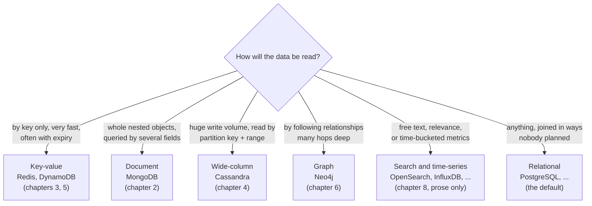

# 1. Why NoSQL exists

Time: about 45 minutes of reading, plus a 5-minute quiz (`make check-01`). No database needed.

You know relational databases: tables with fixed columns, rows identified by a primary
key, joins between tables, SQL to ask any question you like, and transactions that make a
group of changes all-or-nothing. That model is so good that it is still the right default
for most systems. This chapter explains what problems pushed people to build something
else, what those other things are, and when they are the wrong choice.

## What "NoSQL" means

"NoSQL" is not one technology. It is a loose name for databases that give up some part of
the relational model in exchange for something else, usually one of:

- **Scale-out writes.** Spreading data over many machines (called *nodes*) so that adding a
  machine adds capacity, without one primary server that every write must go through.
- **Predictable latency at any size.** Every request reads one small, known piece of
  data, so it costs the same with ten rows or ten billion.
- **A data shape that matches the application.** Storing an application form as one
  nested object instead of spreading it over ten tables.
- **Specialised access patterns.** Following relationships many hops deep, expiring
  data automatically, keeping data in memory.

What they give up varies: ad-hoc joins, a schema the database enforces, multi-row
transactions, or the guarantee that every read sees the latest write. Knowing which one
a given store gave up is most of what you need to use it well.

## The families



| Family | The unit of storage | SQL analogy | Example here |
|---|---|---|---|
| Key-value | a value (string, hash, list, ...) under a key | a two-column table `(key PRIMARY KEY, value)` you can only query by key | Redis (ch. 3), DynamoDB (ch. 5) |
| Document | a JSON-like document with nested objects and arrays | one row whose columns can contain whole tables | MongoDB (ch. 2) |
| Wide-column | rows grouped into *partitions*, sorted inside each partition | a table that is physically clustered by part of its primary key and can only be filtered on that key | Cassandra (ch. 4), DynamoDB's data model (ch. 5) |
| Graph | nodes and relationships, both with properties | tables of entities plus join tables, where the joins are stored, not computed | Neo4j (ch. 6) |
| Search | an inverted index from words to documents | `LIKE '%word%'` that is fast and ranks results | prose in ch. 8 |
| Time-series | measurements keyed by series and time | an append-only table partitioned by time with roll-ups | prose in ch. 8 |

DynamoDB sits between key-value and wide-column: every item has a partition key and an
optional sort key, which is the wide-column idea, but you talk to it one item or one key
range at a time, which is the key-value idea.

## CAP, in plain words

When data is copied to several nodes (*replicated*), the network between them can fail
so that some nodes cannot reach others. That situation is called a **partition**. (This is
a different meaning from Cassandra's partition key, which you meet in chapter 4.)

The CAP theorem says: during a partition, a replicated system must pick one of

- **Consistency (C):** every read sees the latest successful write, as if there were one
  copy. The isolated side refuses requests it cannot answer correctly.
- **Availability (A):** every node that is up keeps answering, even if its answer may be
  out of date or may later conflict with the other side.

"Partition tolerance" is not really a choice: networks do fail, so a distributed system
has to do *something* when they do. CAP is about what it does. Two more things CAP does
not say, which trip people up:

- It says nothing about the normal case, when there is no partition. Most of the time
  there is none.
- "Consistency" in CAP means *linearizability* (behaving like a single copy). It is not
  the C in ACID, which means "transactions keep the data valid by your rules".

## PACELC: the trade-off you pay every day

PACELC extends CAP with the case that matters most of the time:

- **if Partition (P):** choose **A**vailability or **C**onsistency (that is CAP);
- **Else (E)**, when everything is healthy: choose **L**atency or **C**onsistency.

The "else" half is the everyday one. To be sure a read sees the latest write, the
database has to contact more replicas, or the leader, and wait for them. That costs
latency. Not waiting is faster and sometimes stale. You will see this directly in
chapter 4, where Cassandra lets you pick per query how many replicas must answer.

Rough placement, with the caveat that most of these are configurable:

| System | Default leaning | Where you can change it |
|---|---|---|
| Cassandra | PA/EL: available and fast, eventually consistent | consistency level per query (ch. 4) |
| DynamoDB | writes go through one leader per partition (PC); default reads are eventually consistent (EL) | `ConsistentRead=true` on the base table (ch. 5) |
| MongoDB (replica set) | PA/EC in the textbook placement; with today's defaults (`w: majority`, reads from the primary) it behaves closer to PC/EC | read preference and read/write concern |
| Redis (replicated) | asynchronous replication: a failover can lose recent writes | `WAIT`/`WAITAOF` and persistence settings lower the risk but do not remove it (ch. 3) |
| Neo4j cluster (Enterprise) | leader-based writes | not covered: this guide runs Community |

## Consistency models you will meet

From strongest to weakest, in the words you will see in documentation:

- **Linearizable (strong):** once a write is acknowledged, every later read anywhere
  sees it. Cassandra's lightweight transactions give you this for a single partition.
  DynamoDB's conditional writes are an atomic compare-and-set on one item, but a later
  read only sees the newest value with `ConsistentRead=True` on the base table (GSI
  reads are always eventually consistent).
- **Read-your-writes:** you always see your own writes, others may not yet. MongoDB
  offers this with causally consistent sessions.
- **Monotonic reads:** you never see time go backwards: once you have seen a value,
  you do not later see an older one.
- **Eventual consistency:** if writes stop, all replicas eventually agree. Until then a
  read may return an older value. This is the default for Cassandra at consistency
  level `ONE` and for DynamoDB reads without `ConsistentRead`.

Data engineers feel these models in extraction: an incremental extract that reads a
replica may miss a write that the primary already acknowledged. A watermark set from that
read then skips it forever. Chapters 2 and 7 come back to this.

## Things that are the same everywhere

Some ideas carry across every chapter, so they are worth naming now.

- **Access patterns first.** In SQL you design tables, then write queries. In most NoSQL
  stores you list the queries first and design the keys so that each query reads one
  small, contiguous piece of data. Cassandra and DynamoDB force this on you.
- **The primary key is a physical decision.** It decides which node holds the data and
  how it is sorted on disk. Changing it later means rewriting the table.
- **Denormalisation is normal.** Storing the same fact in two places (a payment in a
  "by loan" table and a "by day" table) is how you serve two access patterns. Keeping the
  copies in step becomes your job.
- **No joins at query time, or expensive ones.** Joins move to write time (embed the
  data) or to the analytics side (the lake and DuckDB in this guide).

## When NOT to use NoSQL

Stay relational when:

- **The questions are not known yet.** Finance, risk and regulators will ask things
  nobody planned. A normalised schema plus SQL answers them. A key-designed store answers
  only the questions its keys were designed for.
- **You need multi-row invariants.** A ledger whose postings must balance, a loan whose
  balance must equal the sum of its transactions. Relational databases do this every day;
  most NoSQL stores do it only within one key, or with extra cost.
- **The data is small.** One well-indexed PostgreSQL server handles more than most
  teams need. Distributed databases add operational cost from day one.
- **The team knows SQL and not the alternative.** The cost of a store you operate badly
  is higher than the cost of one that is slightly less suited.

A useful rule: choose NoSQL for a *specific* access pattern that a relational database
serves badly, not as a general replacement. Chapter 8 turns this into a decision guide.

## Where a data engineer fits

Application teams pick operational stores for their own reasons. Data engineers are then
asked to get the data out, reliably and repeatedly, into a place where people can ask any
question. That is the thread of this guide: each chapter shows how one family stores and
serves data, then how to extract from it incrementally, how to handle its schema (or lack
of one), and how to prove the copy is complete.

## Exercise

Open `exercises/ch01_foundations.py`, replace each `None` with a letter, and run:

```bash
make check-01
```

A wrong answer prints a one-line explanation. With all answers right:

```text
Checking exercises/ch01_foundations.py
  PASS  question 1.1: Lookup by id plus expiry is exactly what a key-value store with TTLs does.
  ...
Chapter 1 (foundations quiz): 6/6 passed (checked exercises/ch01_foundations.py)
```

## What is not verified

- This chapter is conceptual; nothing in it is measured. The PACELC placements are the
  usual textbook placements for default configurations, not results of tests run here.
- Behaviour of replicated clusters (partitions, failover) is not demonstrated anywhere in
  this guide: every lab runs a single node.

## Further reading

- Eric Brewer, "CAP Twelve Years Later: How the 'Rules' Have Changed" (IEEE Computer, 2012).
- Daniel Abadi, "Consistency Tradeoffs in Modern Distributed Database System Design"
  (IEEE Computer, 2012), which introduced PACELC.
- Martin Kleppmann, *Designing Data-Intensive Applications*, chapters 5 and 9.
- [Jepsen consistency models](https://jepsen.io/consistency) for precise definitions.
