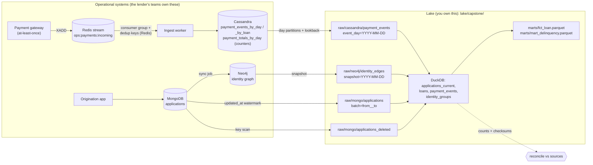

# 7. Capstone: from four NoSQL systems to a loan-level fact table

Time: about 2.5 hours (5 minutes to run, the rest reading the code and doing the exercises).

```bash
make capstone   # starts MongoDB, Redis, Cassandra and Neo4j, then runs everything below
make check-07   # after the exercises; 7.4 reads the capstone's output
make down
```

The capstone puts the previous chapters together. Larkspur Lending (fictional) runs four
operational systems. You own the pipelines that copy them into a Parquet lake, build an
analytics model in DuckDB, and prove that the copy is complete, including after a re-run
and a backfill.

## The systems and the pipeline



| System | Holds | Chapter |
|---|---|---|
| MongoDB `larkspur_ops.applications` | application documents, with the loan embedded once funded | 2 |
| Redis db 7 | the payment gateway's stream, the ingest worker's consumer group, idempotency keys | 3 |
| Cassandra keyspace `larkspur_ops` | payment events in two query-first tables, plus a per-day counter table | 4 |
| Neo4j | applications linked by phone, device and address | 6 |

The code is in `src/nosqlde/capstone/`: `sources.py` simulates the operational side,
`extract.py` is the pipeline, `model.py` is the DuckDB model, `reconcile.py` compares
sources with the lake, and `pipeline.py` runs the story.

## The story `make capstone` runs

1. **Reset** all four systems and delete `lake/capstone/`, so every run starts the same.
2. **Initial load.** The sources are moved to 20 June 2025. The pipeline runs for the
   first time.
3. **Six months pass.** The sources move to 31 December 2025: new applications, decisions
   and fundings, six months of payments (some late, some delivered twice), and three
   applications hard-deleted after erasure requests. The pipeline runs incrementally.
4. **Re-run.** The pipeline runs again with no source changes. Nothing new may be
   written: the raw lake must have the same row count and checksum as before.
5. **Backfill.** March's payments are re-extracted, as if a bug had been fixed. Nothing
   may change.
6. **Model and reconcile.** DuckDB builds the curated tables and the marts; every source
   is reconciled against them.

The pipeline itself took 7.4 seconds on the author's laptop (71.9 s for `make capstone`
including starting the containers; timings vary between runs) and ended with:

```text
reconciliation: 6/6 OK; re-run and backfill idempotent: True
capstone finished in 7.4s: PASS
```

## Ingest: Redis stream to Cassandra, with idempotency

Before each pipeline run, the operational side moves forward. The payment gateway
`XADD`s every payment that arrived in the period, and about 3% of them twice, because it
delivers at least once. The ingest worker reads the stream through a consumer group:

- `worker-1` reads 200 entries and "crashes" without acknowledging them;
- `worker-2` processes everything else, then `XAUTOCLAIM`s worker-1's 200 entries;
- for each entry: skip it if `ops:dedup:<event_id>` exists; otherwise write the event to
  both Cassandra tables, add it to the day's counters, then set the dedup key and `XACK`.

```text
source changes applied before each run:
              as_of       apps new  apps changed  apps erased  stream deliveries  redelivered  dups skipped  events written
------------  ----------  --------  ------------  -----------  -----------------  -----------  ------------  --------------
before run 1  2025-06-20  2251      0             0            3085               200          94            2791
before run 2  2025-12-31  142       75            3            9145               200          273           8672
```

For the first period: 2,791 events, 94 duplicate deliveries, 200 redeliveries after the
crash: 3,085 deliveries, 2,791 writes. Duplicates matter here because of the counter
table: Cassandra counters are not idempotent (`events = events + 1` twice is 2), so without
the dedup keys the daily totals would be wrong. The reconciliation below proves they are
right.

The order "write, then set the dedup key, then ack" has a known window: a crash after the
counter update and before the dedup key would double-count on redelivery. The
alternatives move the window rather than close it, which is why the totals are
reconciled rather than trusted (chapter 3 discusses this).

## Extract 1: MongoDB, with a watermark and a key scan

`extract.extract_mongo`:

1. Read the previous watermark from `lake/capstone/_state/state.json`.
2. Ask the source for its current maximum `updated_at`. That value, not the wall clock,
   is the top of this run's window: `(previous watermark, source max]`.
3. Read the window with a **projection** of only the fields the lake needs. Names, dates
   of birth, emails and phone numbers never leave the source, so there is less to secure
   and less to erase later.
4. Flatten, conform to the target schema (chapter 2's drift handling), and write one
   Parquet file named after the window, e.g.
   `batch=20250620T...__20250711T045400.parquet`. Re-running the same window writes the
   same file name, so it overwrites instead of duplicating.
5. Only then save the new watermark.
6. Compare the set of `_id`s in the source with the ids in the lake. Ids that disappeared
   are written to `raw/mongo/applications_deleted/`, because a watermark can never see a
   hard delete.

The target schema now includes `marketing_consent`, the field chapter 2 found in
`_rescued`: schema evolution done deliberately. Columns that are absent by design (no
loan before funding, no decision before deciding) are declared optional, so the drift
report shows only real drift:

```text
drift report for the run 1 application batch:
  rows: 2251
  missing     borrower__employment__status: 100
  coerced     requested_amount from string: 174
```

And the three erasures are caught by the key scan:

```text
erased in the source: ['A0000004', 'A0000048', 'A0000052']; detected by the key scan: 3
```

## Extract 2: Cassandra, by day partition with a lookback

Payment events are extracted from `payment_events_by_day`, the table chapter 4 modelled
for exactly this. Each run reads whole day partitions, from three days before the last
extracted day up to the run's date, and **overwrites** one Parquet file per day
(`event_day=2025-03-14/part-0.parquet`). Two properties follow:

- **Late events are picked up.** An event paid on 19 June that reaches the lender on
  21 June lands in the 19 June partition, which run 1 had already extracted. Run 2 starts
  at 17 June, three days before run 1's last day:

  ```text
  late events (paid before 2025-06-20, arrived after run 1): 2; run 2 re-read 3 days before its watermark to pick them up
  ```

  Choose the lookback from the measured arrival delay, plus a margin. The generator
  delays a few events by up to three days, so three days is enough here.
- **Re-runs and backfills are safe by construction.** Extracting a day twice produces the
  same file at the same path. A backfill is the same function called with an explicit
  date range.

## Extract 3: Neo4j, as a snapshot

The identity graph is small, so each run exports all edges to
`raw/neo4j/identity_edges/snapshot=<date>/`. Re-running on the same date overwrites the
same snapshot. The model uses the latest snapshot.

## Runs, re-run and backfill

```text
pipeline runs:
run                mongo rows  deletes found  cassandra days          partitions  payment rows  neo4j edges  seconds
-----------------  ----------  -------------  ----------------------  ----------  ------------  -----------  -------
run 1 initial      2251        0              2025-01-01..2025-06-20  138         2791          6753         0.21
run 2 incremental  217         3              2025-06-17..2025-12-31  198         8814          7170         0.24
run 3 re-run       0           0              2025-12-28..2025-12-31  4           111           7170         0.09
```

Run 2 read 217 application documents: 142 new and 75 changed, exactly the source
changes. Run 3 read none, and rewrote only its four lookback days. The raw layer's
fingerprints (row count plus order-independent checksum, chapter 7's exercise 7.2)
before and after the re-run, and after the March backfill:

```text
raw mongo application rows: before 2468 rows, checksum e82c607f38bb629e | after 2468 rows, checksum e82c607f38bb629e | unchanged
raw cassandra payment rows: before 11463 rows, checksum 4475019d3f9b667b | after 11463 rows, checksum 4475019d3f9b667b | unchanged
rewrote 31 day partitions (410 rows) in 0.07s
raw mongo application rows: unchanged (2468 rows, checksum e82c607f38bb629e)
raw cassandra payment rows: unchanged (11463 rows, checksum 4475019d3f9b667b)
```

The raw Mongo layer holds 2,468 rows for 2,393 applications on purpose: it keeps every
version extracted (2,251 + 217). The curated layer picks the latest.

## The model

`model.py` rebuilds everything from raw with `CREATE OR REPLACE`, so the model is a pure
function of the lake:

- `applications_current`: the latest version of each application
  (`row_number() OVER (PARTITION BY application_id ORDER BY updated_at DESC) = 1`),
  minus detected deletes.
- `loans`: the flattened `loan__*` columns of funded applications.
- `payment_events`: all day partitions, deduplicated on `event_id` as a guard.
- `identity_groups`: connected components of the identity edges (union-find, chapter 6),
  with the number of distinct borrowers in each.
- `fct_loan`: one row per loan as of 31 December 2025: instalments due (from the
  repayment schedule), instalments paid, arrears, **days past due** (DPD) and its bucket,
  and a `ring_flag` for loans in an identity group of three or more borrowers.
- `mart_delinquency`: one row per origination month and product, with counts per DPD
  bucket and the 30+ DPD rate.

Days past due is computed the usual way for instalment loans: payments are applied to
the oldest instalment first, and DPD is the number of days since the oldest instalment
that is still unpaid fell due. A few rows of `fct_loan`:

```text
('L0000006', 'home_improvement', 11, 11, 0, 'current', Decimal('0.00'), False)
('L0000030', 'personal', 11, 0, 321, '90+', Decimal('4049.21'), True)
('L0000361', 'home_improvement', 10, 8, 54, '30-59', Decimal('2471.28'), False)
```

(columns: loan_id, product, instalments_due, instalments_paid, days_past_due,
dpd_bucket, arrears, ring_flag; read with DuckDB from `lake/capstone/marts/fct_loan.parquet`.)

L0000030 is a member of the first planted ring and never paid: a first-payment default,
which is what the generator gives ring loans. Across the book:

```text
dpd_bucket  loans  arrears
----------  -----  ---------
current     1319   0.00
1-29        49     31334.76
30-59       12     18828.80
60-89       14     32255.88
90+         84     307007.79
ring_flag  loans  share 30+ dpd
---------  -----  -------------
False      1441   0.0541
True       37     0.8649
```

86% of ring-flagged loans are 30+ days past due, against 5% of the rest. On real data
that kind of gap is the start of an investigation, not a conclusion; here it is how the
data was generated.

One time-zone trap, handled in `model.connect`: DuckDB converts `TIMESTAMPTZ` to `DATE`
in the session's time zone, which defaults to the machine's. A payment at 23:30 UTC
would fall on the next day on a laptop in UTC+1, and the DPD numbers would change with
the reader's location. Every model connection runs `SET TimeZone = 'UTC'`.

## Reconciliation

Each check reads the same columns from the source and from the model, fingerprints both
sides, and compares (`src/nosqlde/capstone/reconcile.py`):

```text
OK   mongo applications (id, status, updated_at) source    2390  lake    2390  checksum match
OK   mongo loans (id, principal, rate)          source    1478  lake    1478  checksum match
OK   cassandra payment events                   source   11463  lake   11463  checksum match
OK   cassandra daily counters vs lake sums      source     332  lake     332  checksum match
OK   neo4j identity edges                       source    7170  lake    7170  checksum match
OK   redis dedup keys vs lake events (count)    source   11463  lake   11463  checksum match
```

- 2,390 applications: 2,393 generated minus the 3 erased.
- 11,463 payment events, not 11,465: two events paid on 30-31 December had not reached the
  lender by the end of 31 December. The lake agrees with the source, which is the point;
  they will arrive in the next run's lookback.
- The Cassandra side of the event check is read by token range (chapter 4); the counter
  check compares Cassandra's per-day counters with the lake's per-day sums, which is what
  proves the dedup keys worked.

A checksum only helps if both sides print values the same way. `recon.canonical`
normalises instants to UTC with microseconds, prints `12500.0` and `Decimal("12500.00")`
identically, and keeps NULL distinct from an empty string. Most false alarms in real
reconciliations come from these details, not from lost rows.

## What is in the lake afterwards

```text
lake: lake/capstone/ holds 340 Parquet files, 4.6 MB (including warehouse.duckdb)
```

```text
lake/capstone/
  raw/mongo/applications/batch=<from>__<to>.parquet
  raw/mongo/applications_deleted/detected=<time>.parquet
  raw/cassandra/payment_events/event_day=YYYY-MM-DD/part-0.parquet
  raw/neo4j/identity_edges/snapshot=YYYY-MM-DD/part-0.parquet
  curated/identity_groups.parquet
  marts/fct_loan.parquet, marts/mart_delinquency.parquet
  warehouse.duckdb            (every curated and mart table)
  _state/state.json           (watermarks and the run log)
  _manifests/NNN-<run>.json   (what each run read and wrote)
```

Explore it with DuckDB from Python:

```bash
uv run python -c "import duckdb; print(duckdb.connect('lake/capstone/warehouse.duckdb').sql('FROM mart_delinquency LIMIT 5'))"
```

## Exercises

`exercises/ch07_capstone.py`:

1. `dpd_bucket(days)`: the bucket boundaries, and rejecting negative input.
2. `order_independent_checksum(rows)`: the reconciliation checksum. The check makes sure
   a duplicated row changes it, which rules out the tempting XOR.
3. `days_to_extract(...)`: which day partitions a run must (re)read.
4. `rate_30_plus_by_product_sql(path)`: a DuckDB query over `fct_loan.parquet`.

```bash
make check-07
```

```text
Checking solutions/ch07_capstone.py
  PASS  7.1 dpd_bucket: all bucket boundaries correct, negative input rejected
  PASS  7.2 order_independent_checksum: order-independent; detects changed, duplicated and missing rows
  PASS  7.3 days_to_extract: first run, lookback window and go-live floor all correct
  PASS  7.4 rate_30_plus_by_product_sql: auto=0.0787, home_improvement=0.0758, personal=0.0688

Chapter 7 (capstone): 4/4 passed (checked solutions/ch07_capstone.py)
```

Further ideas, unchecked: replace the Mongo watermark extract with a change-stream
consumer that stores its resume token in `_state/`; make the ingest worker survive a
crash between the counter update and the dedup key; break the lookback (set it to 0) and
watch the counter reconciliation fail.

## What is not verified

- The capstone runs at a small scale (2,000 borrowers, about 11,000 payments) on one
  laptop; its timings say nothing about production volumes.
- The crash window in the ingest worker (after the counter update, before the dedup key)
  is described, not exercised.
- The DPD calculation assumes equal instalments paid in full, which is how the generator
  creates payments; partial payments, fees and restructures are not modelled.
- The model is rebuilt in full on every run; incremental model builds are not covered.
