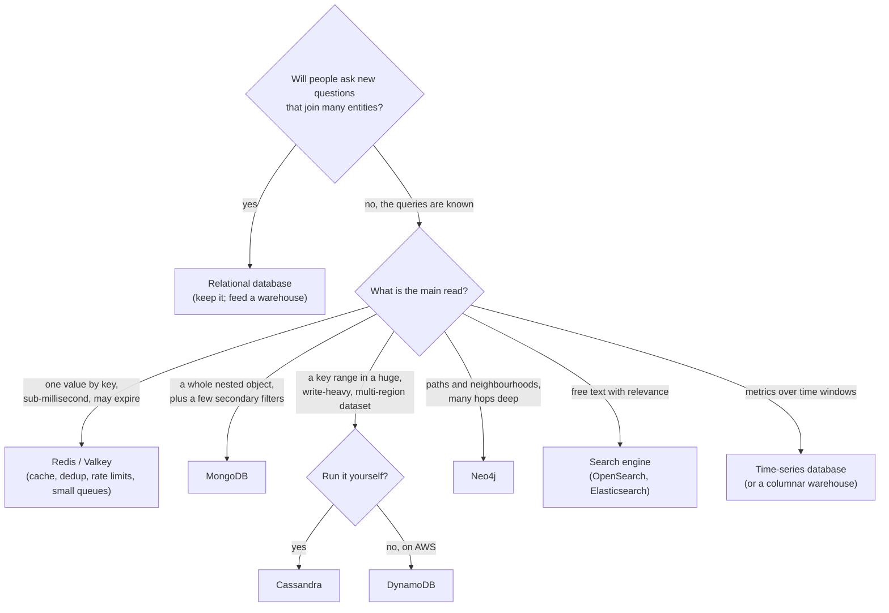

# 8. Choosing a NoSQL database

Time: about 1 hour of reading, plus a 5-minute quiz (`make check-08`). No database needed.

This chapter pulls the guide together: how to choose a store, what each one is bad at,
what the managed versions cost you in money and operations, two families the labs did
not cover, a glossary, and review questions with answers.

## A decision guide

Start from the access patterns, not from the product.



Then sanity-check the choice with four questions:

1. **Can I write down the primary key of every query?** If not, the data is not ready
   for a key-designed store (Cassandra, DynamoDB).
2. **What happens to a write during a failure?** Know the persistence and replication
   defaults (Redis RDB-only, Cassandra consistency levels, DynamoDB eventual reads).
3. **How will the data get to analytics?** Plan the extraction before go-live: a
   watermark field and an index on it, a CDC feed (change streams, DynamoDB Streams),
   or a time-bucketed table (Cassandra).
4. **Who operates it at 3 a.m.?** A managed service is often cheaper than the people
   needed to run a distributed database well.

## Comparison

| | MongoDB | Redis | Cassandra | DynamoDB | Neo4j |
|---|---|---|---|---|---|
| Family | document | key-value (in memory) | wide-column | key-value / wide-column (managed) | graph |
| Data model | nested JSON-like documents | strings, hashes, lists, sets, sorted sets, streams | partitions of sorted rows | items in partitions, sorted by sort key | nodes and relationships with properties |
| Query by non-key fields | yes, with secondary indexes | by key only with the core types; the bundled Query Engine adds secondary queries (not used here) | only within a partition, or with SAI indexes | through GSIs you define | yes, with indexes; strongest at traversals |
| Joins | `$lookup` (use sparingly) | no | no | no | traversals replace joins |
| Transactions | multi-document (replica set) | `MULTI`/`EXEC` on one node, Lua | LWT on one partition | up to 100 items | ACID on one instance |
| Scales writes by | sharding | Redis Cluster sharding | adding nodes (leaderless) | automatic partitioning | mostly vertical (Enterprise clustering adds secondaries for reads and availability; writes per database still go to one leader) |
| CDC for pipelines | change streams | keyspace notifications (not durable), streams | CDC log (not covered) | DynamoDB Streams, export to S3 | no built-in CDC in Community; query by timestamp |
| Typical data engineering pain | schema drift, deletes vs watermarks | volatility, eviction | full scans, tombstones, no ad-hoc queries | scan cost, 1 MB pages, single-table design | getting graph results into tables |
| Licence of the image used here | SSPL | RSALv2 / SSPLv1 / AGPLv3 (Redis 8) | Apache 2.0 | AWS DynamoDB Local licence | GPLv3 (Community) |

## Anti-patterns

- **Using `ALLOW FILTERING` or `Scan` + `FilterExpression` as a query.** It works in
  development and reads the whole table in production (chapters 4 and 5).
- **A low-cardinality partition key** (status, product, payment method). One partition
  gets most of the data and traffic (chapter 4, step 4.4).
- **Queues in Cassandra.** Row-by-row deletes create tombstones that every read pays for.
- **Unbounded arrays in a document** (every payment of a loan inside the loan). Documents
  approach the 16 MB limit and every update rewrites more.
- **Redis as the only copy of important data with default persistence.** AOF is off in
  the default configuration; a crash loses writes since the last snapshot.
- **One Redis for cache and for pipeline state with an `allkeys-*` eviction policy.**
  Eviction removes dedup keys and stream entries as readily as cache entries.
- **Watermark extraction without an index on the watermark field**, or without a plan for
  deletes (chapter 2, step 2.9).
- **"Schemaless" meaning "no schema anywhere".** The schema moves into application code
  and into your pipeline. Write it down (`$jsonSchema`, a target schema in the pipeline)
  and count drift.
- **Choosing NoSQL for scale you do not have.** A single PostgreSQL server handles a
  great deal; distributed systems cost operational effort from day one.
- **Testing only against local emulators.** DynamoDB Local does not throttle and almost
  never shows eventual consistency (chapter 5).

## Search and time-series, in brief

Neither got a lab, to keep the guide's container set small. Both come up often.

**Search engines** (OpenSearch, Elasticsearch, Apache Solr) build an **inverted index**:
for each term, the list of documents containing it. That gives fast full-text search,
relevance ranking (BM25 by default in these engines), fuzzy matching, and aggregations
for faceted navigation. A search index is usually a *derived* store: the system of
record is elsewhere and a pipeline keeps the index in step, often via CDC. For data
engineers that means the same problems as the rest of this guide in reverse: idempotent
indexing (use the source id as the document id), handling deletes, and full reindexing
into a new index behind an alias when mappings change. Redis 8 also bundles a search
module (`MODULE LIST` on this guide's Redis shows `search`), which is useful for smaller
data that already lives in Redis.

**Time-series databases** (InfluxDB, TimescaleDB, Prometheus for metrics; Redis 8 also
ships a `timeseries` module) store measurements keyed by series and time. They optimise
for appends, time-range queries, downsampling into roll-ups, and retention policies that
drop old data in whole chunks (the same reason chapter 4 recommends time buckets). For
analytics on business events (payments, applications), a columnar warehouse or Parquet
partitioned by day, as in the capstone, is often enough; dedicated time-series stores
earn their place for high-frequency operational metrics.

## Managed services: cost and operations

Each family has managed offerings. This guide does not run them; the notes below say
what they are and what tends to drive cost and effort. Check current pricing and feature
lists on the providers' sites before deciding.

| Service | What it is | Cost drivers to model | What it takes off your plate, and what it does not |
|---|---|---|---|
| **MongoDB Atlas** | MongoDB run by MongoDB Inc. on AWS, Azure or GCP | cluster tier (memory, CPU, storage), number of nodes, backups, data transfer | patching, replica sets, backups, monitoring; you still design documents and indexes |
| **Amazon ElastiCache** (Redis OSS and Valkey engines), **Amazon MemoryDB**, **Redis Cloud** | managed in-memory stores; MemoryDB adds a durable transaction log | node size and count, replicas, data transfer | failover and patching; you still choose eviction and persistence trade-offs |
| **Amazon Keyspaces**, **DataStax Astra DB** | Cassandra-compatible managed services (CQL) | reads and writes per request or provisioned, storage | nodes, repair, compaction; check each service's documented differences from Apache Cassandra before porting |
| **Amazon DynamoDB** | the service chapter 5 emulates | on-demand requests or provisioned capacity, storage, GSIs (each has its own writes), PITR, Streams reads, exports | everything operational; you own key design, and a bad design shows up directly on the bill |
| **Neo4j AuraDB** | Neo4j run by Neo4j Inc. | instance size (memory), tier | operations and Enterprise features such as clustering in higher tiers |

General points:

- **Self-managed is not free.** Cassandra needs regular repair, compaction tuning, JVM
  tuning and careful upgrades; a cluster typically needs several nodes per data centre
  to tolerate failures. People's time is usually the largest cost.
- **Request-priced services punish full scans.** A nightly full `Scan` of a large
  DynamoDB table can cost more than the application's daily traffic; prefer export to
  S3 or Streams for pipelines.
- **Data transfer adds up**: cross-region replication, cross-zone traffic and egress to
  your warehouse are often billed separately.
- **Licences matter for self-hosting and redistribution**, not usually for using a
  managed service: SSPL (MongoDB, and one of Redis 8's options) places conditions on
  offering the software as a service; AGPLv3 (Redis 8 option) and GPLv3 (Neo4j
  Community) are copyleft. This is not legal advice; read the licence texts.

## Glossary

- **Access pattern:** a query the application needs, stated with its key and order
  ("payments of a loan, newest first").
- **AOF (append-only file):** Redis's write log, replayed on start.
- **At-least-once delivery:** every message is delivered, possibly more than once.
- **BSON:** MongoDB's binary JSON format, with extra types (dates, decimals).
- **CAP theorem:** during a network partition, choose consistency or availability.
- **CDC (change data capture):** reading a database's change log instead of its tables.
- **Change stream:** MongoDB's CDC API, built on the oplog.
- **Clustering key:** Cassandra's sort order of rows inside a partition.
- **Compaction:** merging on-disk files in Cassandra, which is when tombstones are dropped.
- **Consistency level:** in Cassandra, how many replicas must answer a query.
- **Consumer group:** Redis Streams' way for several workers to share a stream.
- **Dead-letter queue:** where messages go after failing too many times.
- **Denormalisation:** storing the same fact in several places to serve several queries.
- **Document:** a JSON-like record with nested objects and arrays.
- **Eventual consistency:** replicas converge if writes stop; reads may be stale until then.
- **Eviction:** Redis deleting keys to stay under `maxmemory`.
- **GSI (global secondary index):** a DynamoDB index with a different partition key.
- **Hot partition:** a partition that gets far more data or traffic than others.
- **Idempotent:** doing it twice has the same effect as doing it once.
- **Idempotency key:** a record that an operation was already done, checked before doing it.
- **Item collection:** DynamoDB items sharing a partition key.
- **LWT (lightweight transaction):** Cassandra's compare-and-set, using Paxos.
- **Multikey index:** a MongoDB index on an array field, one entry per element.
- **Oplog:** MongoDB's replication log; change streams read it.
- **PACELC:** CAP plus "else, latency or consistency".
- **Partition (data):** in Cassandra or DynamoDB, all rows with the same partition key.
- **Partition (network):** nodes that cannot reach each other.
- **Partition key:** the part of the primary key that decides where data lives.
- **PEL (pending entries list):** delivered-but-unacknowledged entries of a Redis consumer group.
- **Quorum:** a majority of replicas, floor(RF / 2) + 1.
- **RDB:** a Redis point-in-time snapshot file.
- **Replication factor (RF):** how many copies of each partition a keyspace keeps.
- **Resume token:** the position in a MongoDB change stream to continue from.
- **Schema drift:** the gradual change in the shape of data in a source without an enforced schema.
- **Single-table design:** storing several entity types in one DynamoDB table.
- **Token / token range:** the hash of a Cassandra partition key, and a slice of the ring of hashes.
- **Tombstone:** a Cassandra deletion marker.
- **TTL (time to live):** an expiry on a key, row or item.
- **Watermark:** the highest change timestamp (or id) a previous extract saw.

## Review questions, with answers

Try to answer each before reading the answer.

**1. Why can't you rely on an `updated_at` watermark to capture every change from MongoDB?**
It misses hard deletes, writes that forget to set `updated_at`, and changes whose
timestamp is older than an already-taken watermark (clock skew, long transactions). Use
an overlap plus deduplication, a periodic key comparison, or change streams.

**2. A change stream consumer was down for a week. What can go wrong when it restarts?**
Its resume token may no longer be in the oplog, so resuming fails. It must re-snapshot
the collection and start a new stream; size the oplog window for your longest outage.

**3. How do you design a Cassandra table for "all payments of a loan, newest first"?**
Partition key `loan_id`, clustering key `(event_time DESC, event_id)`. The event_id stops
two payments at the same instant from overwriting each other.

**4. Why is a `status` column a bad Cassandra partition key?**
Few distinct values means a few huge, ever-growing partitions on a fixed set of
replicas: a hot partition. Bucket it, or choose a key with many values.

**5. With RF 3, which consistency levels give read-your-writes?**
Any pair where R + W > 3, for example QUORUM writes and QUORUM reads (2 + 2).

**6. How do you extract a whole Cassandra table in parallel without duplicates?**
Split the token ring into contiguous `(start, end]` ranges and query
`token(pk) > start AND token(pk) <= end` for each, in parallel; record finished ranges
so a failure resumes.

**7. What is the difference between `Count` and `ScannedCount` in DynamoDB?**
`ScannedCount` is how many items were read; `Count` is how many matched the filter.
You pay for `ScannedCount`. A large gap means the key design does not fit the query.

**8. How do you make "record a payment and add it to the balance" safe against retries in DynamoDB?**
A `TransactWriteItems` with a conditional put of the payment item
(`attribute_not_exists`) and the balance update; a retry fails the condition and
cancels the update too.

**9. Redis is configured with `allkeys-lru` and holds pipeline dedup keys. What is the risk?**
Under memory pressure, Redis may evict dedup keys, and duplicates are then processed
again. Use `noeviction`, or a separate instance for state. A `volatile-*` policy is not
enough when the dedup keys have a TTL, as they usually do: those are exactly the keys it evicts.

**10. A Redis Streams consumer crashes after reading entries. What happens to them?**
They stay in the group's pending entries list, owned by the dead consumer, forever,
until another consumer claims them with `XAUTOCLAIM`/`XCLAIM`. Redis does not
redeliver automatically.

**11. Why does a checksum for reconciliation use addition rather than XOR?**
Both are order-independent, but XOR cancels a duplicated row (h XOR h = 0), so a
duplicate would be invisible. Addition modulo 2^64 counts it.

**12. Your reconciliation shows equal counts but different checksums. Where do you look first?**
Representation, before data loss: time zones and timestamp precision (BSON is
millisecond), decimal versus float formatting, NULL versus empty string, trailing spaces.

**13. When would you choose a graph database over SQL recursive queries?**
When the questions are traversals of variable, unknown depth over many relationships,
asked interactively (fraud rings, lineage, networks). For one-off analysis, exporting
edges and using a recursive CTE or union-find in the warehouse is often enough.

**14. How do you make a re-run of an incremental extract not duplicate data?**
Derive output locations from the data's boundaries (the watermark window, the day
partition), write atomically, overwrite instead of appending, save state only after
data, and deduplicate by key in the curated layer as a guard.

**15. Why is a late-arriving event a problem for a day-partitioned extract, and how do you handle it?**
It lands in a day that was already extracted. Re-read a lookback window of recent days on
every run (sized from measured delays), and reconcile per-day counts so a miss is caught.

## Exercise

`exercises/ch08_choosing.py` has seven scenario questions. Replace each `None` with a
letter and run `make check-08`; a wrong answer prints the reasoning.

```text
Chapter 8 (choosing a store quiz): 7/7 passed (checked exercises/ch08_choosing.py)
```

## What is not verified

- Nothing in this chapter was measured. Managed services were not used; their
  descriptions are general and their pricing is deliberately not quoted.
- Search and time-series databases have no lab here.
- Licence notes describe the licence files of the images pinned in this repository (see
  the README); they are not legal advice.
